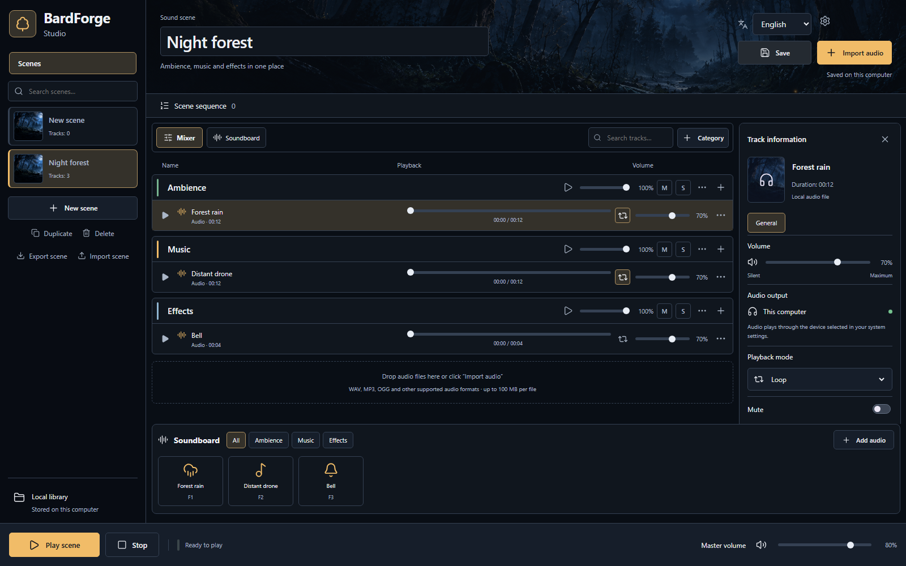

# BardForge Studio

[Русский](README.md) · English

**Build an atmosphere and control it while you play.** Layer rain, background music and one-shot effects in a saved scene. BardForge's first usable tool is a local mixer for tabletop RPGs, D&D and other games and storytelling sessions. Voice processing, AI, music tools and additional integrations are future directions.

**Windows x64 development build. No public stable installer is available yet.** The official core application is free and its source code is licensed under [MIT](LICENSE).

Actual `0.1.0-dev.3` browser preview, using built-in synthesized sounds; not a future UI mockup.

## What works today

- Import local WAV, MP3 and OGG audio; create categories and nested groups with volume, mute and solo.
- Play scenes or individual soundboard tiles; use F1–F12 while the app is focused.
- Save and duplicate scenes; export and import portable `.bardforge` packages with audio.
- Arrange timed or manually advanced scene sequences.
- Switch the entire UI between Russian and English without changing custom names. Choose theme, accent and mixer density.

The local mixer needs no Foundry account or separately installed Node.js/Python. Optional Python preparation is available for future modules; AI models and a module catalog are not implemented.

## Try your first scene

1. In the app, choose **Try demo scene** to load **Night forest**.
2. Use the bottom scene playback control and adjust Ambience, Music and Effects.
3. Trigger a soundboard tile for a single sound, or pause/stop the scene.
4. Choose **Save** and wait for the saved status.
5. Choose **New scene**, then **Import audio** for your own material.

The installer is named `BardForge-Studio-Setup-<version>.exe`. Development builds are unsigned and do not receive stable-release updates. No download is advertised before a release is approved. Stable update delivery between published versions is **NOT VERIFIED**.

The detailed documentation is currently in Russian: [installation](docs/getting-started/installation.md), [first scene](docs/getting-started/first-scene.md), [user guides](docs/README.md), [FAQ](docs/faq.md). The application UI itself supports both languages.

## Availability and roadmap

The separate [Foundry integration](https://github.com/BardForge/bardforge-foundry) is **experimental**: receiver, signaling relay and transport SDK exist, but Studio has no integrated sender panel. Playback in a real Foundry world with a remote player and TURN is **NOT VERIFIED**.

Standalone presets, public Plugin SDK, a module catalog, device routing, Discord, Voice Changer and AI generation are planned. No release dates are promised. See the [roadmap](docs/roadmap.md).

## Development and community

[Build](docs/development/building.md), [architecture](docs/development/architecture.md), [tests](docs/development/testing.md), [contributing](CONTRIBUTING.md), [security](SECURITY.md), [shared board](https://github.com/orgs/BardForge/projects/1), [discussions](https://github.com/orgs/BardForge/discussions).

Topic branches target `dev`; `main` and releases require the owner's decision. The core repository is maintained by the BardForge organization. Foundry's canonical repository is `BardForge/bardforge-foundry`; copies in Core support existing tests and are not an independently maintained product.

## License and AI-Assisted Development

Original software and accompanying technical text: [MIT](LICENSE). Preserve copyright and permission notices. The name, logo and brand assets are separate; no brand endorsement permission is granted. Dependencies, third-party audio, models and datasets retain their own terms. See [licensing scope](LICENSING.md) and [third-party notices](THIRD_PARTY.md).

BardForge is developed with assistance from artificial intelligence tools. AI may contribute to code, documentation, testing, and technical design. All contributions remain subject to human review, validation, and applicable licensing requirements.
