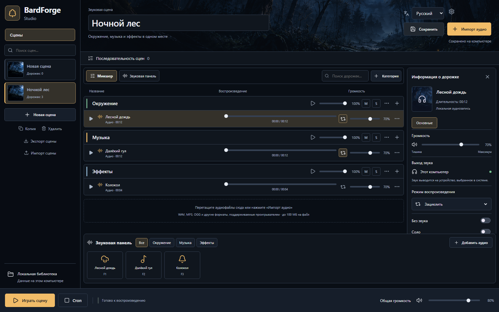

# BardForge Studio

Русский · [English](README.en.md)

**Соберите звуковую атмосферу и управляйте ею во время игры.** Дождь за окном таверны, фоновая музыка и внезапный удар грома — в одной сцене, с отдельной громкостью каждого слоя.

BardForge — модульная аудиоплатформа. Первый работающий инструмент — локальный микшер для настольных RPG, включая D&D и другие системы, игровых встреч и звукового сопровождения историй. Музыка, обработка голоса, AI и новые интеграции — дальнейшие направления, а не обещание уже доступных функций.

**Сейчас: development-версия для Windows x64. Публичного стабильного установщика пока нет.** Основное приложение бесплатно, исходный код — [MIT](LICENSE). [Установка и доступность](docs/getting-started/installation.md).

Снимок работающего интерфейса `0.1.0-dev.3`, браузерный просмотр. Только встроенные синтезированные звуки; это не концепт будущего интерфейса.

## Что можно делать сейчас

- Импортировать локальные WAV, MP3, OGG и объединять их в звуковые сцены.
- Создавать собственные категории и вложенные подкатегории; менять громкость, Mute и Solo.
- Запускать сцену целиком или отдельные звуки с панели и клавишами F1–F12.
- Сохранять, копировать и переносить сцены вместе с аудио в файле `.bardforge`.
- Соединять сцены в последовательность с ручным переключением или таймером.
- Полностью переключать интерфейс RU/EN, выбирать тему и плотность микшера. Пользовательские названия сохраняются.

Локальному микшеру не нужны Foundry, аккаунт или отдельно установленный Python. Windows-установщик включает необходимые компоненты приложения. Python для будущих расширений загружается отдельно по желанию; AI-моделей и каталога дополнений пока нет.

## Первая сцена за несколько шагов

1. В открытом приложении нажмите **«Попробовать демосцену»** — появится «Ночной лес» с тремя звуками.
2. Нажмите кнопку воспроизведения всей сцены в нижней панели.
3. Настройте уровни «Окружение», «Музыка» и «Эффекты». Одиночные звуки можно запускать плитками.
4. Нажмите **«Сохранить»**, дождитесь «Сохранено на компьютере».
5. Для собственной сцены выберите **«Новая сцена» → «Импорт аудио»**.

Подробно: [первый «Ночной лес»](docs/getting-started/first-scene.md) · [все руководства](docs/README.md) · [частые вопросы](docs/faq.md).

## Готовность возможностей

| Состояние                              | Возможности                                                                                                                                                           |
| -------------------------------------- | --------------------------------------------------------------------------------------------------------------------------------------------------------------------- |
| Работают в development-сборке          | Локальный микшер, вложенные группы, сцены, звуковая панель, последовательности, RU/EN, темы, экспорт/импорт                                                           |
| Эксперимент                            | [Foundry](docs/integrations/foundry.md): отдельный приёмник, relay и транспортный SDK; нет готовой панели отправителя в Studio и проверки реального удалённого игрока |
| Требует проверки опубликованных версий | Доставка автообновления между двумя релизами; публичных релизов ещё нет                                                                                               |
| Планируется                            | Отдельные пресеты, Plugin SDK, каталог модулей, маршрутизация устройств, Discord, Voice Changer, AI и музыкальные инструменты                                         |

Лимиты и поведение данных: [импорт и дорожки](docs/user-guide/tracks.md), [сцены и резервные копии](docs/user-guide/scenes.md). [Roadmap](docs/roadmap.md) не содержит обещанных дат.

## Разработчикам и участникам

[Сборка](docs/development/building.md) · [архитектура](docs/development/architecture.md) · [проверки](docs/development/testing.md) · [CONTRIBUTING](CONTRIBUTING.md) · [безопасность](SECURITY.md).

Разработка идёт через тематические ветки и PR в `dev`. `main` и релизы — только после решения владельца. Основной репозиторий пока находится в личном аккаунте автора; организационные материалы — в [BardForge](https://github.com/BardForge). Foundry развивается в [https://github.com/BardForge/bardforge-foundry](https://github.com/BardForge/bardforge-foundry); копии в Core сохранены для существующих проверок, а не как параллельная ветка продукта.

Помочь можно [сообщением об ошибке](https://github.com/ShinozakiAichi/BardForge-Studio/issues), улучшением документации, тестированием или участием в [Discussions](https://github.com/orgs/BardForge/discussions). Задачи собраны на [общей доске](https://github.com/orgs/BardForge/projects/1). Официальные сборы пожертвований не объявлены.

## Лицензия и AI-Assisted Development

Код — [MIT](LICENSE). Сохраняйте авторские уведомления. MIT не распространяется автоматически на бренд, логотип, стороннее аудио, зависимости или AI-модели: [LICENSING](LICENSING.md), [THIRD_PARTY](THIRD_PARTY.md), [ограничения](DISCLAIMER.md).

BardForge is developed with assistance from artificial intelligence tools. AI may contribute to code, documentation, testing, and technical design. All contributions remain subject to human review, validation, and applicable licensing requirements.
