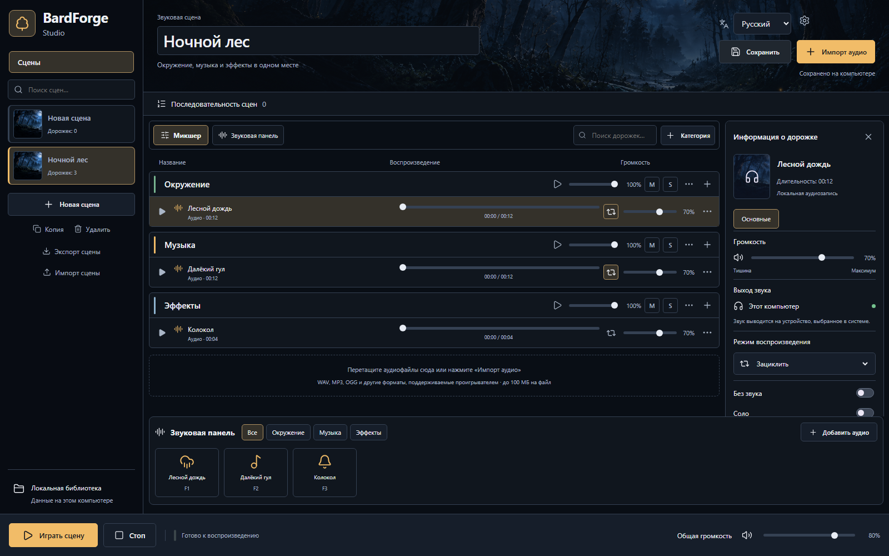

# Первая сцена: «Ночной лес»

[Документация](../README.md) → Первая сцена

Нужна открытая development-сборка BardForge; [доступность установщика](installation.md) описана отдельно.

## Быстро попробовать без своих файлов

1. В пустой сцене нажмите **«Попробовать демосцену»**. Если уже есть дорожки, сначала создайте «Новую сцену».
2. Появятся «Ночной лес» и три синтезированных звука в группах окружения, музыки и эффектов.
3. Нажмите воспроизведение сцены в нижней панели. Ползунки групп позволяют менять баланс.
4. Нажмите **M**, чтобы временно убрать слой, и ещё раз — вернуть. **S** оставляет выбранные солирующие дорожки или группы.
5. Нажмите «Стоп». Измените название сверху, нажмите «Сохранить» и дождитесь статуса «Сохранено на компьютере».

Демо помогает познакомиться с управлением; это три синтезированных звука, а не библиотека профессиональных записей леса.

## Собрать свой лес

1. Создайте **«Новую сцену»**, в поле названия введите «Ночной лес».
2. Подготовьте собственные или разрешённые к использованию записи: дождь, фоновую музыку и одиночный эффект.
3. В нужной группе откройте меню «…» → **«Добавить аудио»**. Общая кнопка «Импорт аудио» добавляет в первую группу; назначение можно сменить в параметрах дорожки.
4. Откройте параметры дождя и выберите «Зациклить». Для одиночного эффекта выберите **«Один раз»**.
5. Установите умеренную общую громкость, затем отрегулируйте соотношение дорожек на слух.
6. Сохраните сцену. Нажмите **«Экспорт сцены»**, чтобы получить файл `.bardforge` с настройками и аудио.

Запуск всей сцены запускает все её дорожки, включая эффекты. Если эффект нужен только по событию, запускайте фон кнопками групп, а эффект — плиткой. Подробности: [микшер](../user-guide/audio-mixer.md), [звуковая панель](../user-guide/soundboard.md).
